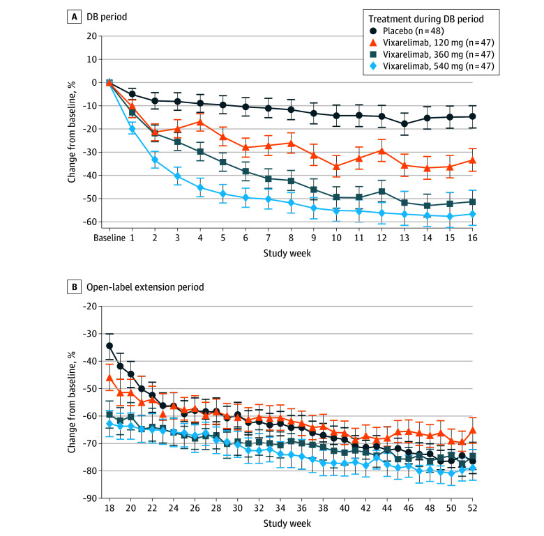

# Prurigo Nodularis

## Background

In the recent publication ["Vixarelimab in Patients With Prurigo Nodularis: A Randomized Clinical Trial"](https://pubmed.ncbi.nlm.nih.gov/41405882/) (DOI: 10.1001/jamadermatol.2025.4950) the study results were presented using the following plot:

**Figure 2. Least-Squares Means of Percentage Change From Baseline in Weekly Mean Worst Itch Numeric Rating Scale during the Double-Blind (DB) Period and Open-Label Extension Period**

Footnote: Patients who received placebo in the DB period received vixarelimab, 360 mg, subcutaneously once every 2 weeks during the open-label extension period. Error bars indicate 95% CIs.

Importance: Prurigo nodularis (PN) is a chronic inflammatory skin disease characterized by severe pruritus and nodule formation, significantly affecting patients' quality of life. There is an unmet need for effective therapies to address both symptoms and disease progression.

## Challenge

Observe the plot and evaluate the design decisions made. Check what graphical principles can be used to improve the plot. Ask yourself: What is the main message? And how can this be visually supported?

## Data

The original data is not freely available. Simulated data will be made available to mimic the results of the study.
