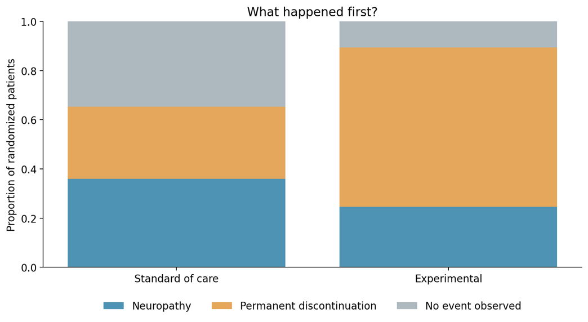
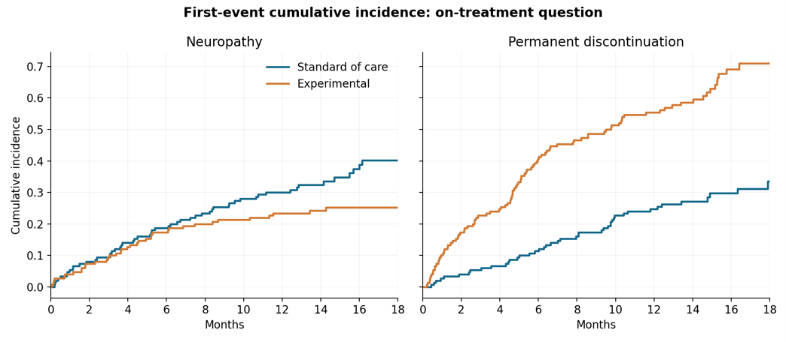
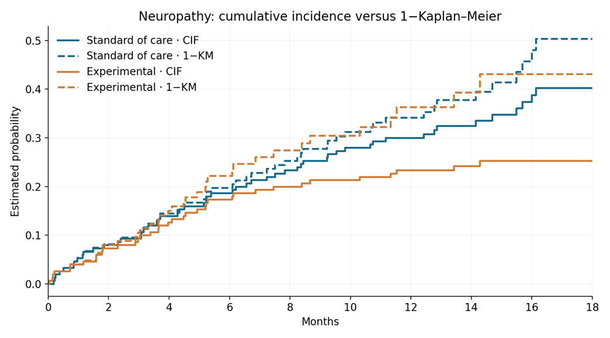
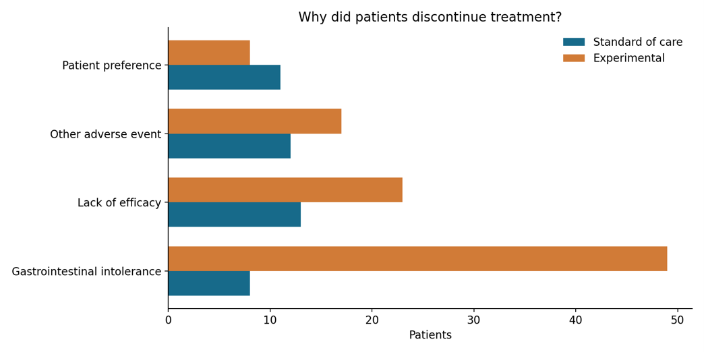

# Treatment Safety

**Is the New Treatment Safer — or Are Patients Simply Stopping It Earlier?**

A time-to-event analysis with competing risks

## Background

A pharmaceutical company has completed a randomized study comparing an experimental therapy with standard of care in patients with a chronic inflammatory disease. The clinical team is concerned about peripheral neuropathy, an adverse event that may develop with prolonged treatment exposure. Initial summaries suggest fewer neuropathy events in the experimental arm. The team asks whether this means the new therapy has a more favorable neuropathy safety profile.
Not every patient remains on randomized treatment. Some permanently discontinue treatment for reasons including tolerability, lack of efficacy, and patient preference. The study captures the first occurrence of neuropathy, permanent discontinuation, or the end of available follow-up.

## Challenge

Using visualization as your primary tool, explore whether the observed neuropathy results support the proposed safety claim. What additional questions arise from the way follow-up and treatment discontinuation are recorded?

* Explore how and when different first events occur across randomized groups.
* Decide which time-to-event quantities are clinically meaningful and which statistical methods match those questions.
* Investigate the influence of permanent treatment discontinuation on interpretation of neuropathy risk.
* Compare at least two visual approaches and explain what each reveals or obscures.
* Communicate a balanced conclusion for a multidisciplinary clinical development team.

Deliverable: up to three visualizations plus a short commentary (approximately 250–500 words) describing your key discoveries, assumptions, and limitations. Any statistical software is welcome. The challenge is open and free to participate.

## Data

The accompanying [Excel workbook](../2026-11-11/Data_Time_to_event_competing_risk.xlsx) is provided in Excel format. contains 300 simulated randomized patients (150 per treatment arm). Each record is one patient. Variables include treatment, age, sex, baseline severity, prior neurotoxic exposure, follow-up time, first-event code and label, discontinuation reason, and administrative follow-up duration. See the Data dictionary worksheet for definitions.
Event coding: 0 = no event observed (censored); 1 = neuropathy; 2 = permanent treatment discontinuation before neuropathy. Times are in months. The dataset does not systematically record neuropathy after discontinuation. All records are synthetic and are not evidence about a real treatment.

## For organizers: What learnings or skills does this challenge test?

Keep this section separate from the participant-facing brief if you want to preserve the discovery element.

* Recognizing that a competing event is defined relative to the clinical estimand: permanent discontinuation precludes first ON-TREATMENT neuropathy, but does not biologically prevent later neuropathy.
* Distinguishing cumulative incidence functions from 1−Kaplan–Meier when competing first events exist; understanding why censoring discontinuation changes the target and may be informative.
* Exploring event timing, first-event composition, and reasons for discontinuation before choosing a model.
* Communicating treatment trade-offs without claiming lower intrinsic neurotoxicity from a lower observed on-treatment neuropathy incidence.
* Identifying the data limitation: a treatment-policy neuropathy risk after discontinuation is not identifiable directly from this first-event-only dataset.
* Practicing accessible, clear visual design: denominators, risk sets, axis scaling, uncertainty, subgroup caveats, and clinical interpretation.

Organizer simulation note: The experimental arm was designed to have substantially more early discontinuation, with no direct treatment effect on the underlying on-treatment neuropathy hazard. Do not reveal this before participants present. These plots are examples, not the only valid solutions.

## Suggested participant visualizations (organizer examples)

1. First-event mix
**Stacked proportions reveal the distribution of neuropathy, discontinuation, and censoring.**

2. Cumulative incidence of both first events
**Aalen–Johansen cumulative incidence curves display neuropathy and discontinuation side by side.**

3. CIF versus 1−Kaplan–Meier
**Shows the effect of censoring discontinuations in a conventional KM analysis.**

4. Discontinuation reasons
**Grouped bars explore why patients stop treatment and whether the reasons differ by arm.**

Reproducible R code is supplied separately. The example PNGs were generated independently from the same CSV data because R was unavailable in the preparation environment; running the R script reproduces the corresponding analyses and figures.
